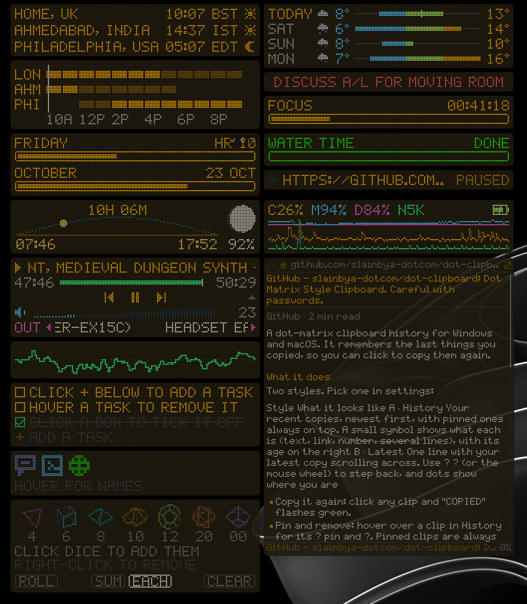
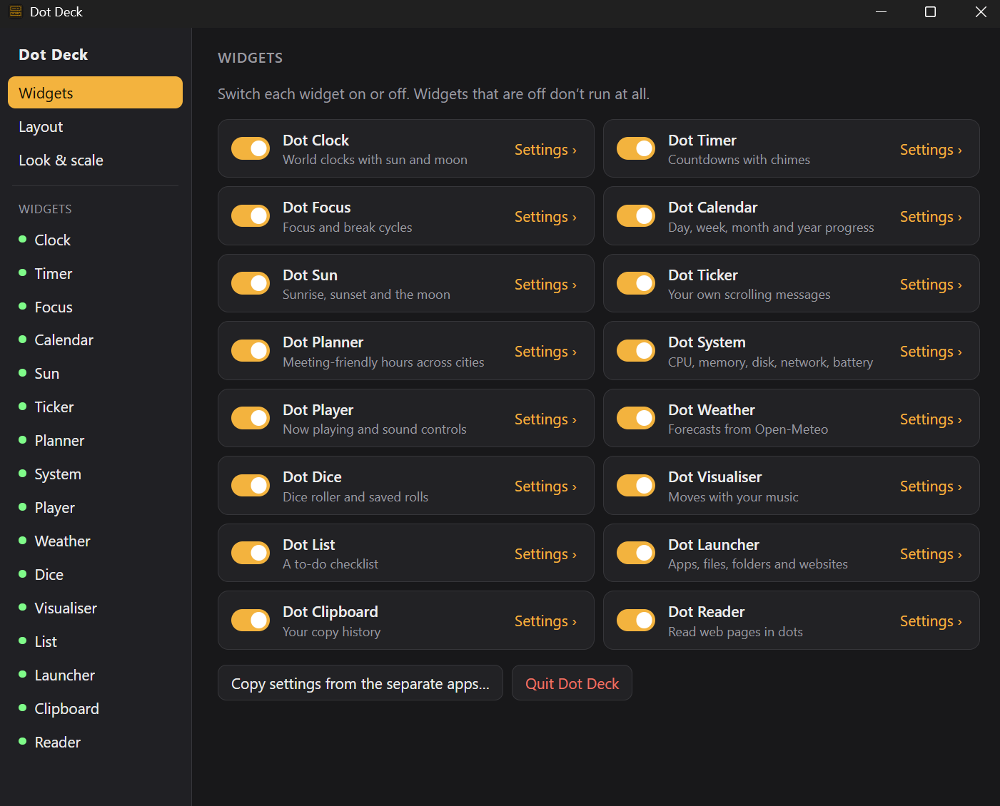
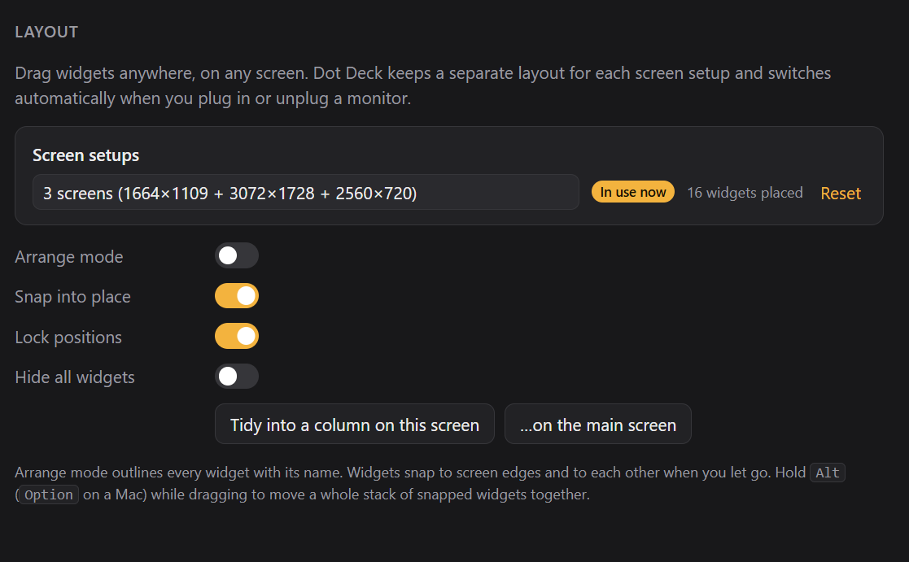
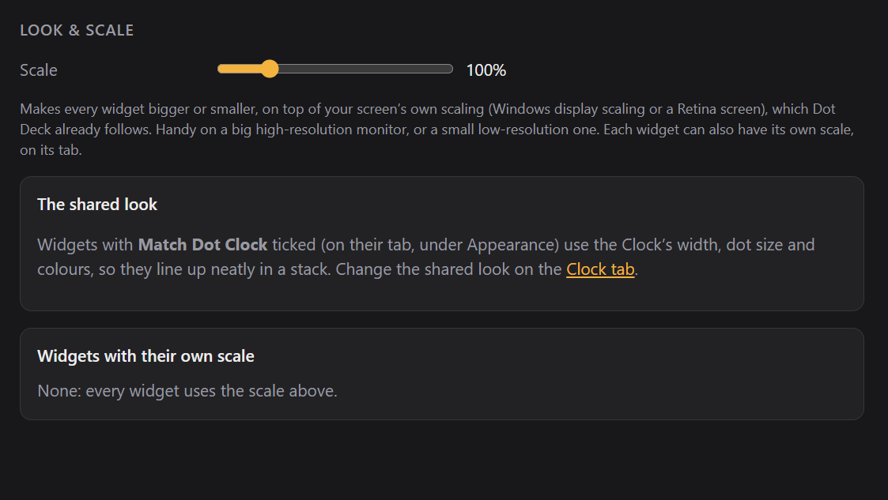

# Dot Deck

All the Dot widgets in one app, for Windows and macOS. Switch each widget on or off, arrange them anywhere on any screen, and Dot Deck remembers a separate layout for your laptop on its own and for your laptop plus a big monitor.

## The widgets

| | | | |
|---|---|---|---|
| **Clock**: world clocks | **Timer**: countdowns | **Focus**: focus / break cycles | **Calendar**: day to year progress |
| **Sun**: sunrise, sunset, moon | **Ticker**: scrolling messages | **Planner**: meeting-friendly hours | **System**: CPU, memory, disk, network, battery |
| **Player**: now playing, sound controls | **Weather**: forecasts | **Dice**: dice roller, saved rolls | **Visualiser**: moves with your music |
| **List**: to-do checklist | **Launcher**: apps, files, folders, sites | **Clipboard**: copy history | **Reader**: web pages in dots |

Each one works exactly like its separate app, with the same settings and the same look.

## Settings

One window, with a sidebar:

- **Widgets:** an on/off switch for each widget. Widgets that are off don't run at all, so the clipboard watcher and the audio listener only start while their widget is on. **Copy settings from the separate apps** brings over your cities, timers, tasks, saved rolls and so on.
- **Layout:**
  - every screen setup Dot Deck has seen, which you can rename, reset or remove
  - **Arrange mode:** every widget gets an outline and its name
  - **Snap into place**, and **Lock positions**
  - **Hide all widgets**
  - **Tidy into a column**
- **Look & scale:** a **scale slider (50–300%)** for every widget, and a list of the widgets with their own scale.
- **A tab for each widget:**
  - its on/off switch
  - its own scale
  - **Find it**: moves it to the middle of its screen
  - **Copy from the app**: brings that widget's settings over from its separate app
  - **Reset**: puts that widget back to how it starts
  - below that, its full settings page

## Placing widgets

- **Drag** a widget anywhere, on any screen. When you let go it **snaps** to nearby screen edges, and lines up or stacks neatly with other widgets.
- **Hold Alt** (Option on a Mac) while dragging to move a whole **stack** of snapped widgets together.
- **Layouts per screen setup:** Dot Deck recognises which screens are connected. Unplug the monitor and everything goes back to your laptop layout. Plug it in again and your desk layout returns.
- **A new setup** starts from the last layout you used, and anything that would land off-screen is brought back on.
- **The shared look:** widgets with **Match Dot Clock** ticked (on their tab, under Appearance) use the Clock's width, dot size and colours, so stacks line up.

## Where it lives

Dot Deck sits in the **system tray** (the menu bar on a Mac):
- **Left-click** the icon for settings.
- **Right-click** for:
  - every widget's on/off switch
  - Hide all widgets
  - Arrange mode
  - Tidy into a column
  - Quit

A widget's own ✕ switches that widget off; it doesn't quit Dot Deck.

## Building it yourself

See [BUILDING.md](BUILDING.md).

Weather data by Open-Meteo.com (CC BY 4.0). Reading mode uses Mozilla Readability (Apache 2.0).

## Check out the Singular Widgets

[Dot Calendar](https://github.com/slainbya-dotcom/dot-Calendar)
[Dot Clipboard](https://github.com/slainbya-dotcom/dot-clipboard)
[Dot Clock](https://github.com/slainbya-dotcom/dot-clock)
[Dot Deck](https://github.com/slainbya-dotcom/dot-deck)
[Dot Dice](https://github.com/slainbya-dotcom/dot-dice)
[Dot Focus](https://github.com/slainbya-dotcom/dot-focus)
[Dot Launcher](https://github.com/slainbya-dotcom/dot-launcher)
[Dot List](https://github.com/slainbya-dotcom/dot-list)
[Dot Planner](https://github.com/slainbya-dotcom/dot-planner)
[Dot Player](https://github.com/slainbya-dotcom/dot-player)
[Dot Reader](https://github.com/slainbya-dotcom/dot-reader)
[Dot Sun](https://github.com/slainbya-dotcom/dot-sun)
[Dot System](https://github.com/slainbya-dotcom/dot-system)
[Dot Ticker](https://github.com/slainbya-dotcom/dot-ticker)
[Dot Timer](https://github.com/slainbya-dotcom/dot-timer)
[Dot Visualiser](https://github.com/slainbya-dotcom/dot-visualiser)
[Dot Weather](https://github.com/slainbya-dotcom/dot-weather)